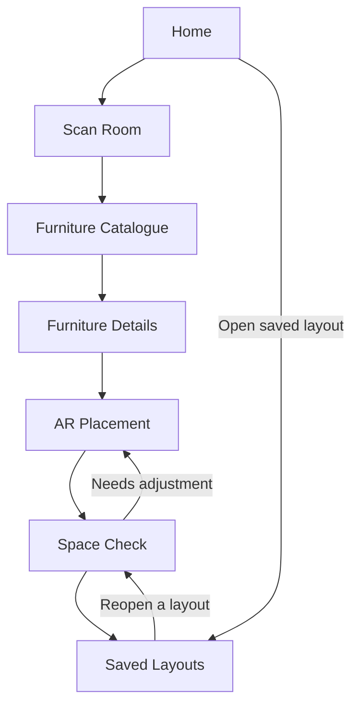

# NESTAR — AR Furniture Placement for Small Rooms

> **A UI/UX design project exploring how Augmented Reality (AR) can help people visualise furniture in compact rooms before they buy or rearrange it.**

**Live Figma prototype:** [Explore the NESTAR prototype](https://www.figma.com/proto/78LR2DjlaBp5lwwcitsvEi/ui-ux-project?node-id=1-92&p=f&viewport=-14%2C179%2C0.24&t=t3BIKWpuaMv61ARl-1&scaling=min-zoom&content-scaling=fixed&starting-point-node-id=1%3A92&page-id=0%3A1)

---

## Table of Contents

- [Project Overview](#project-overview)
- [The Problem](#the-problem)
- [Our Proposed Solution](#our-proposed-solution)
- [Why UI/UX Is Critical to This Project](#why-uiux-is-critical-to-this-project)
- [Target Users](#target-users)
- [Key Features](#key-features)
- [Complete Prototype Walkthrough](#complete-prototype-walkthrough)
- [Main User Flow](#main-user-flow)
- [Design Approach](#design-approach)
- [Important UX Considerations](#important-ux-considerations)
- [Scope and Current Project Status](#scope-and-current-project-status)
- [Limitations](#limitations)
- [Future Enhancements](#future-enhancements)
- [Tools and Resources](#tools-and-resources)
- [How to View the Prototype](#how-to-view-the-prototype)
- [Project Learning Outcomes](#project-learning-outcomes)

---

## Project Overview

**NESTAR** is a proposed mobile experience for planning furniture placement in small rooms. It focuses on a common problem: people may like a piece of furniture online, but it can be difficult to judge how large it will look in their own room, whether it will fit through a doorway, or how much usable walking space will remain after it is placed.

The concept combines a furniture catalogue with an Augmented Reality placement experience. A user follows a guided flow to scan or set up a room, selects furniture, previews it in the room, checks spatial feedback, and saves a layout for later.

The project is primarily a **UI/UX design and interactive-prototyping project**. The Figma prototype demonstrates the intended screens, navigation and user journey. It should not be mistaken for a production AR application: live camera tracking, automatic room measurement, collision detection and real-world clearance calculations would need to be implemented and validated separately.

### Project at a Glance

| Item | Details |
|---|---|
| Project name | NESTAR |
| Project type | UI/UX design concept and clickable prototype |
| Domain | Interior planning, furniture visualisation and Augmented Reality |
| Platform concept | Mobile application |
| Primary audience | People furnishing or rearranging compact rooms |
| Main objective | Help users make more informed furniture-placement decisions |
| Prototype tool | Figma |
| Main design focus | Scale awareness, spatial feedback and tracking confidence |

---

## The Problem

People living in compact bedrooms, apartments, hostels or shared accommodation often have limited floor space. Choosing furniture for these rooms can be difficult because product photographs and catalogue dimensions do not always communicate how an item will look or feel in the user's actual space.

A person may know that a sofa is 160 cm wide, for example, but still struggle to imagine how much room it will occupy. Even when the furniture physically fits, it might block a doorway, make a walking path uncomfortable, or leave too little space for other items.

### Common user problems

- **Unclear scale:** It is difficult to understand the real size of furniture from catalogue images.
- **Space uncertainty:** Users may not know how much walking space will remain.
- **Door and access conflicts:** Furniture may interfere with door opening or movement around the room.
- **Repeated rearrangement:** Users may need to move heavy furniture several times to find a suitable layout.
- **Low confidence:** A user may hesitate to purchase an item because they cannot picture it in their own room.

### Problem statement

> How might we help people living in small rooms preview furniture at a trustworthy scale, understand available clearance, and confidently choose a practical layout before purchasing or rearranging furniture?

---

## Our Proposed Solution

NESTAR proposes a guided mobile experience in which users can:

1. Start a new room-planning session.
2. Scan or set up their room.
3. Browse a catalogue of furniture.
4. View the dimensions of a selected item.
5. Place and adjust a virtual furniture model in the room.
6. Review walking-space and door-clearance feedback.
7. Save the arrangement for future reference.

The experience is designed around three particularly important challenges:

### 1. Scale accuracy

The virtual object must represent the furniture's real-world dimensions as closely as the available device and product data allow. A visually attractive but incorrectly scaled model could mislead the user. NESTAR therefore gives dimensions a visible place in the furniture-selection and placement journey.

### 2. Spatial feedback

The user needs more than a 3D object on the screen. They need to understand how the object affects the room. The concept includes feedback for walking paths, door swing and possible overlap so that users can evaluate whether a layout is practical.

### 3. Tracking drift

In an AR implementation, the position of a virtual object can appear to shift when tracking becomes unstable. This can reduce trust in the preview. The proposed experience includes a tracking-status indicator and a clear warning/retry approach for situations where tracking quality is weak.

---

## Why UI/UX Is Critical to This Project

UI/UX is not just about making an application look modern. In NESTAR, the quality of the user experience directly affects whether a person can understand and trust the furniture preview.

An AR furniture app can have technically impressive 3D models and camera features, but those features are not useful if people cannot figure out how to scan a room, interpret dimensions, correct an object's position or understand a warning.

### The role of UX — making the experience usable

**User Experience (UX)** focuses on the complete journey: what the user is trying to accomplish, what information they need, what decisions they make, and how easily they can complete their task.

For NESTAR, good UX is important because it:

- Reduces confusion during room scanning by providing clear instructions.
- Guides first-time users from scanning to selecting and placing furniture.
- Makes important information, such as width, depth and height, easy to find.
- Helps users understand whether a placement is suitable instead of merely showing a virtual object.
- Provides a recovery path when scanning or tracking does not work as expected.
- Reduces unnecessary steps when users want to compare or save layouts.

### The role of UI — making information clear

**User Interface (UI)** is the visual and interactive layer through which users operate the app.

For NESTAR, good UI is important because it:

- Creates a clear visual hierarchy between the room view, furniture information and controls.
- Makes actions such as scan, move, rotate, reset and save easy to recognise.
- Uses readable labels for measurements and spatial warnings.
- Maintains consistent buttons, spacing, typography and component states.
- Uses colour to support status communication without relying on colour alone.
- Keeps the interface visually calm so the user's attention stays on the room and furniture.

### Why this matters in an AR application

| UX/UI challenge | Why it matters | NESTAR design response |
|---|---|---|
| Furniture scale | Incorrect expectations can lead to poor purchase decisions. | Display product dimensions and keep scale central to the placement flow. |
| Room scanning | Users may not know where or how to point the camera. | Provide scanning guidance and a visible tracking status. |
| Spatial understanding | A model can fit visually but still obstruct movement. | Include walking-path and door-swing feedback. |
| Tracking instability | A drifting object can make the preview feel unreliable. | Show tracking status and provide a retry/re-scan message. |
| First-time usability | AR controls may be unfamiliar. | Use a guided, step-by-step journey with recognisable actions. |
| Accessibility | Some users may not distinguish colour-only warnings or small controls. | Pair colours with text/icons and use readable labels and appropriately sized controls. |

**The central design principle:** NESTAR should not simply show users what furniture looks like. It should help them understand whether the furniture is likely to work in their space.

---

## Target Users

The concept is intended for people who need to make the most of limited room space.

### Primary users

- Students living in hostels or compact rented rooms.
- People living in small apartments or studio homes.
- First-time renters or homeowners furnishing a room.
- People who frequently rearrange furniture in limited spaces.

### Secondary users

- Families planning room layouts.
- People comparing furniture options before buying.
- Furniture retailers or interior-planning teams exploring AR-based product visualisation.

### Example user needs

- “Will this sofa fit without blocking the entrance?”
- “How much walking space will remain beside my bed?”
- “Can I compare two different furniture arrangements?”
- “Can I see the furniture in my room before I make a decision?”

These are representative design scenarios, not quotations from completed user interviews.

---

## Key Features

### Room scanning and setup
A guided room-scanning entry point helps users understand how to capture the room. A practical implementation should indicate whether a usable floor surface has been detected and provide retry guidance.

### Furniture catalogue
Users can browse furniture categories and compare product options. Product cards show the item name and dimensions so users can consider size before opening the detail screen.

### Furniture details
A product-detail view presents the furniture preview and its width, depth and height. This makes dimensions part of the decision rather than hidden information.

### AR furniture placement
The concept provides a room view with controls for moving, rotating and resetting the selected furniture. In a working AR application, these controls would manipulate the tracked 3D object.

### Space check
The spatial-feedback concept highlights the walking path and door-swing area. A real implementation would need reliable room geometry, furniture dimensions and door information before it could calculate these checks accurately.

### Saved layouts
Users can revisit saved arrangements instead of starting from the beginning every time. The concept also allows a layout to communicate a general status, such as good fit or needs review.

---

## Complete Prototype Walkthrough

The Figma prototype is organised around seven main screens. Follow the journey below to understand the intended experience.

### Screen 1 — Home

**Purpose:** Give users a clear starting point and make the main action easy to find.

The home screen introduces NESTAR and explains its basic benefit: preview furniture in the user's room. The primary action is **“Scan your room”**. A secondary area gives users access to a previously saved layout.

**User actions:**
1. Open the app.
2. Select **Scan your room** to begin a new planning session.
3. Alternatively, open a saved layout to revisit a previous arrangement.

**UX reasoning:** The main task is prominent, while returning users have a shortcut to their existing work. This reduces the effort required to begin.

### Screen 2 — Scan Room

**Purpose:** Help users prepare the room for furniture placement.

The scan screen provides a camera-oriented scanning area, a short instruction and a tracking-status indicator. The concept communicates whether tracking is good and where the user should direct the camera.

**User actions:**
1. Start scanning.
2. Follow the instruction to move the phone slowly and capture the floor and surrounding area.
3. Check the scanning/tracking feedback.
4. Select **Finish room scan** to continue.

**UX reasoning:** AR scanning can be unfamiliar. Clear instructions and visible status feedback reduce uncertainty. A production version should also explain camera permission, offer retry guidance and support devices or rooms where automatic scanning is unavailable.

### Screen 3 — Furniture Catalogue

**Purpose:** Let users find an item suitable for their room.

The catalogue presents furniture cards and category filters. The concept includes sample items such as a two-seat sofa, compact bed, study desk and slim wardrobe. Each card shows a name, dimensions and an illustrative starting price.

**User actions:**
1. Browse the available furniture.
2. Use the category filters or search concept to narrow the options.
3. Select a furniture card, such as the Milo two-seat sofa.
4. Continue to the product details screen.

**UX reasoning:** Showing dimensions directly on catalogue cards helps users compare options without opening every product. The sample products and prices in the design are illustrative placeholders, not verified retail listings.

### Screen 4 — Furniture Details

**Purpose:** Help users understand the selected product before placing it.

This screen provides a larger product preview, a short description and the item's dimensions. The sample Milo sofa is shown with illustrative dimensions of **160 cm width × 82 cm depth × 78 cm height**.

**User actions:**
1. Review the product preview.
2. Read the width, depth and height.
3. Select **Place in my room** to continue to the AR-placement concept.

**UX reasoning:** Dimensions are presented as decision-making information. Users should not have to search through unrelated screens to find measurements that determine whether furniture may fit.

### Screen 5 — AR Placement

**Purpose:** Let users preview and adjust the selected furniture in the room.

The placement concept combines a room view, a virtual sofa, a tracking indicator and controls for rotate, move and reset. The selected item's dimensions remain visible.

**User actions:**
1. Place the selected furniture in the room.
2. Use **Rotate** to change its orientation.
3. Use **Move** to adjust its position.
4. Use **Reset** to return to the initial placement.
5. Select **Check available space** to review the layout.

**UX reasoning:** The room remains the primary visual focus. Placement controls are kept together, and dimensions remain available so that users can relate the virtual item to its real-world size.

**Important implementation note:** In the current design prototype, the AR scene and controls illustrate the intended interaction. Actual camera tracking, object anchoring, movement and rotation require an AR implementation.

### Screen 6 — Space Check

**Purpose:** Help users evaluate whether the selected arrangement is practical.

The space-check concept shows the room and furniture with feedback for walking clearance and door swing. It distinguishes a positive status from an item that needs review.

**User actions:**
1. Review the walking-path feedback.
2. Check the door-swing feedback.
3. Return to the placement step to adjust the item if necessary.
4. Select **Save this layout** when satisfied.

**UX reasoning:** A furniture preview should support a practical decision, not just a visual one. Walking space and door clearance are important because an arrangement can look attractive while making the room difficult to use.

**Accuracy note:** Any clearance value or status shown in a visual mockup is illustrative unless it is generated by a validated measurement and geometry system.

### Screen 7 — Saved Layouts

**Purpose:** Help users revisit their room-planning work.

The saved-layout screen displays room arrangements as cards, with a short name, a preview and a status label. The concept includes actions to reopen a layout and start another one.

**User actions:**
1. View saved room arrangements.
2. Select a layout to reopen it.
3. Review or continue adjusting the arrangement.
4. Start another layout when needed.

**UX reasoning:** Saving supports comparison and reduces repeated work. It also gives users a reason to return to the app when they are considering multiple furniture options.

---

## Main User Flow

The primary end-to-end journey is:

### Main prototype connections

| Starting screen | Action | Destination |
|---|---|---|
| Home | Scan your room | Scan Room |
| Home | Open saved layout | Saved Layouts |
| Scan Room | Finish room scan | Furniture Catalogue |
| Furniture Catalogue | Select a furniture card | Furniture Details |
| Furniture Details | Place in my room | AR Placement |
| AR Placement | Check available space | Space Check |
| Space Check | Save this layout | Saved Layouts |
| Space Check | Adjust placement | AR Placement |
| Saved Layouts | Open a saved layout | Space Check / layout review |

The exact clickable hotspots and transitions can be explored in the Figma prototype. Some controls in the visual concept may be illustrative rather than fully interactive.

---

## Design Approach

The project follows a human-centred UI/UX workflow inspired by the stages in the course report template.

### 1. Discover — Understand the problem

Identify who experiences difficulty planning furniture for small rooms, what decisions they make and what information they need.

**Research to conduct:** Interview at least five people from the target group. Ask about room constraints, furniture purchases, measuring habits, door clearance and their expectations of AR previews. Record genuine observations and anonymise participant details.

### 2. Define — Focus the design problem

Turn research findings into user needs, personas, an empathy map and a user journey. The central design question is how to make furniture scale and room clearance easier to understand.

**Expected outputs:** At least two evidence-based personas, an empathy map, pain points, a reframed problem statement and a mapped user journey.

### 3. Ideate — Explore possible solutions

Consider alternative flows, such as an AR-first experience, a catalogue-first experience and a guided room-planning experience. Compare them against usability, clarity and support for spatial understanding before selecting a direction.

### 4. Prototype — Make the experience tangible

Create low-fidelity wireframes first, then define visual styles and create high-fidelity screens. Connect the screens in Figma so that a reviewer can follow the main user journey.

### 5. Test — Evaluate with real users

Ask at least five people to complete realistic tasks using the clickable prototype. Observe task completion, hesitation, mistakes and user comments. Improve the design based on actual evidence.

### 6. Reflect — Explain decisions and limitations

Document important design trade-offs, unresolved issues, accessibility considerations and possible future improvements. Be transparent about what the prototype demonstrates and what would require engineering work.

---

## Important UX Considerations

### Clear measurement communication
Width, depth and height should use consistent units and labels. A measurement should be understandable without requiring users to interpret an unfamiliar technical diagram.

### Honest spatial feedback
The interface should not claim that furniture definitely fits when the room scan or measurements are uncertain. It should communicate uncertainty and suggest a manual check when necessary.

### Tracking feedback and recovery
When tracking becomes unstable, users should receive a clear explanation and an action such as pausing, rescanning or repositioning the camera. A silent failure is especially frustrating in an AR workflow.

### Accessible status design
Do not communicate fit, warning or error using colour alone. Pair status colours with text, icons or patterns. Use readable type, clear labels, sufficiently large touch targets and a logical navigation order.

### Privacy and consent
Room scans and camera access can reveal personal information about someone's home. A real app should explain why camera access is required, obtain permission, minimise stored room data and provide clear controls for deleting saved information.

---

## Scope and Current Project Status

### Included in the UI/UX concept

- Seven main mobile screens.
- Guided room-scanning journey.
- Furniture catalogue and product details.
- AR placement screen concept.
- Move, rotate and reset control concepts.
- Walking-space and door-clearance feedback concept.
- Saved-layout screen.
- Clickable navigation between the primary screens in Figma.

### Not implemented by the Figma prototype itself

- Live camera-based room scanning.
- Automatic floor, wall or door detection.
- Real-world measurement calibration.
- Persistent AR object anchoring.
- Actual 3D furniture manipulation.
- Collision detection or validated clearance calculations.
- Backend accounts, cloud synchronisation or a live furniture inventory.

The prototype is intended to communicate the product concept and user experience. It does not by itself prove that the AR measurements or fit recommendations are technically accurate.

---

## Limitations

1. **AR accuracy depends on hardware and environment.** Device sensors, lighting, room surfaces and tracking quality can affect results.
2. **3D model dimensions must be correct.** An inaccurate model can make a product appear to fit when it does not.
3. **Clearance checks need room geometry.** Door swing and walking-path feedback require reliable information about the room and its objects.
4. **A clickable prototype is not a working AR system.** Figma can demonstrate navigation and visual states but cannot validate real-world tracking accuracy.
5. **The catalogue is illustrative.** Sample furniture names, dimensions and prices should be replaced with verified product data in a real application.
6. **User research and usability results must be evidence-based.** Interview findings, task success rates and test outcomes should only be reported after conducting the research and tests.

---

## Future Enhancements

- Integrate a device-supported AR framework such as ARCore or ARKit.
- Use verified 3D furniture models with manufacturer dimensions.
- Add manual room measurement as a fallback.
- Calibrate and communicate measurement confidence.
- Improve door-swing, walking-path and object-overlap calculations.
- Allow users to compare multiple furniture arrangements.
- Add more furniture styles, materials, colours and sizes.
- Support saving, exporting and sharing room plans.
- Improve accessibility and add multilingual guidance.
- Conduct further usability testing across different devices and room layouts.

---

## Tools and Resources

| Tool / resource | Intended use |
|---|---|
| Figma | UI design, screen layouts and clickable prototype |
| SVG | Vector-based screen artwork used as a starting point for the interface |
| ARCore / ARKit | Possible future technologies for real-time AR implementation |
| WCAG 2.2 | Accessibility reference for contrast, interaction and perceivability |
| User interviews and usability testing | Validate the design with target users |

Only list a tool as used in the final submission if it was actually used during the project.

---

## How to View the Prototype

1. Open the [NESTAR Figma prototype](https://www.figma.com/proto/78LR2DjlaBp5lwwcitsvEi/ui-ux-project?node-id=1-92&p=f&viewport=-14%2C179%2C0.24&t=t3BIKWpuaMv61ARl-1&scaling=min-zoom&content-scaling=fixed&starting-point-node-id=1%3A92&page-id=0%3A1).
2. Start from the Home screen.
3. Select **Scan your room**.
4. Follow the main flow through catalogue, product details and AR placement.
5. Continue to Space Check and Saved Layouts.
6. Try the available navigation and interactive elements.

If the prototype does not open, check that the Figma sharing permissions allow viewers with the link to access it.

---

## Project Learning Outcomes

This project demonstrates how UI/UX design can translate a real-world space-planning problem into a structured digital experience.

Key learning areas include:

- Understanding user problems before designing screens.
- Creating personas and mapping user journeys.
- Structuring information and navigation around user tasks.
- Comparing design concepts before choosing a solution.
- Moving from low-fidelity wireframes to high-fidelity UI.
- Building a clickable prototype and defining interaction behaviour.
- Considering accessibility, privacy, trust and error recovery.
- Recognising the difference between a visual prototype and a technically validated product.

---

## Conclusion

NESTAR explores how a guided AR furniture-placement experience could make furnishing compact rooms more understandable and less uncertain. Its value is not limited to showing a virtual sofa or bed in a camera view. The experience must help users interpret dimensions, understand remaining space, recognise tracking problems and make informed decisions.

That is why UI/UX is central to the project: it connects the technical possibility of Augmented Reality to a clear, usable and trustworthy experience for real people.

**Explore the design:** [Open the NESTAR Figma prototype](https://www.figma.com/proto/78LR2DjlaBp5lwwcitsvEi/ui-ux-project?node-id=1-92&p=f&viewport=-14%2C179%2C0.24&t=t3BIKWpuaMv61ARl-1&scaling=min-zoom&content-scaling=fixed&starting-point-node-id=1%3A92&page-id=0%3A1)

---

*Academic UI/UX project. Replace illustrative examples with actual interview findings, usability-test evidence and implementation details as the project progresses.*
